<p align="center">
  
</p>

<h1 align="center">Remi</h1>

<p align="center">
  <b>Derslerin zamanında, grupların tek yerde.</b><br>
  Hocalar için ders grubu ve hatırlatma uygulaması · iOS + .NET API
</p>

<p align="center">
  
  
  
  
  
</p>

---

Remi, birden çok grupla ders yapan hocalar için yazıldı. Her grup bir kez girilir: adı, rengi, WhatsApp ya da
Telegram bağlantısı, günleri, saati ve ne kadar önce hatırlatılacağı. Dersler her hafta kendiliğinden gelir;
Remi her dersten önce bildirim ya da alarmla haber verir, tatildeyken susar.

<p align="center">
  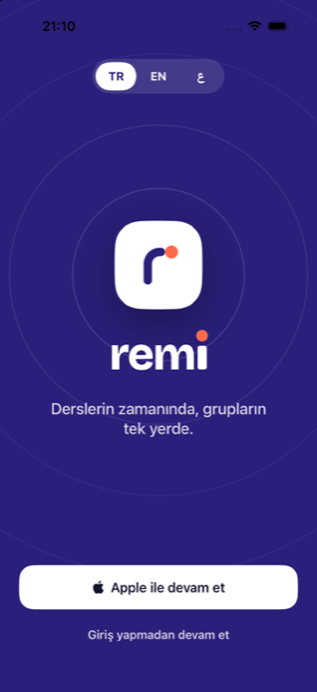
  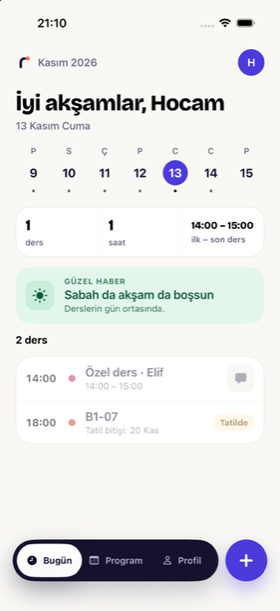
  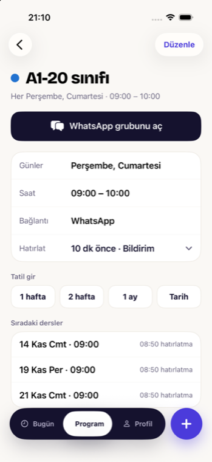
  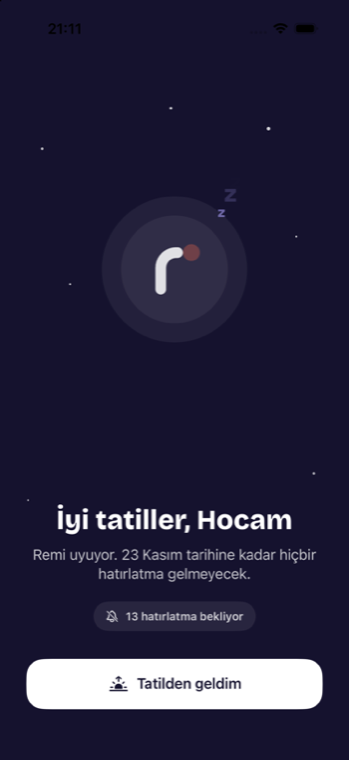
</p>

## Özellikler

**Bugün**
- Minimal hafta şeridi; kaydırınca hafta değişir.
- Günün özeti: kaç ders, toplam kaç saat, ilk ve son ders.
- **Güzel haber:** sabah ya da akşam hiç ders yoksa "Bu sabah boşsun" kartı.
- Sıradaki ders, kalan süre ve tek dokunuşla grubun WhatsApp/Telegram sohbeti.

**Gruplar**
- **Hızlı grup:** yalnız ad, günler ve saat; gerisi otomatik.
- **Yeni grup:** renk, sohbet bağlantısı (yapıştırınca tanınır), süre, hatırlatma.
- Hatırlatma süresi elle yazılmaz, tekerlekle seçilir: 0–60 dakika ya da 1–12 saat önce; bildirim ya da alarm.

**Tatil**
- Bir grubu ya da hepsini tatile al: 1 hafta, 2 hafta, 1 ay ya da istediğin tarihe kadar.
- **Ben tatildeyim:** tüm hatırlatmalar susar, ana sayfa uyur. "Tatilden geldim"e basınca Remi uyanır;
  tarih geçince kendiliğinden uyanır.

**Program**
- Gruplar ya da gün gün hafta görünümü.
- Programı **Excel olarak indir** ya da **yazdır** (bağlantılar ve tatil notlarıyla).

**Kişiselleştirme**
- Türkçe, İngilizce ve Arapça (sağdan sola, Arapça rakamlar).
- Açık, koyu ya da otomatik tema; 6 uygulama rengi.
- Apple ya da Google ile giriş; yedekleme ve cihazlar arası eşitleme. Giriş yapmadan da tam çalışır.

<p align="center">
  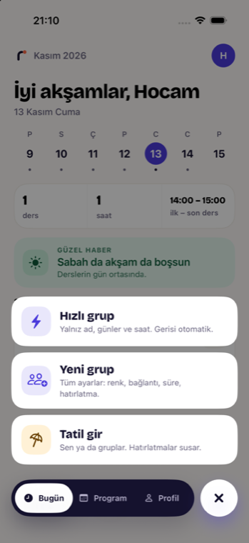
  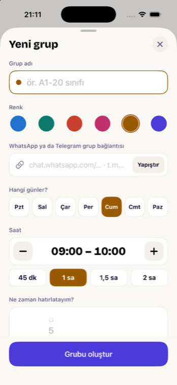
  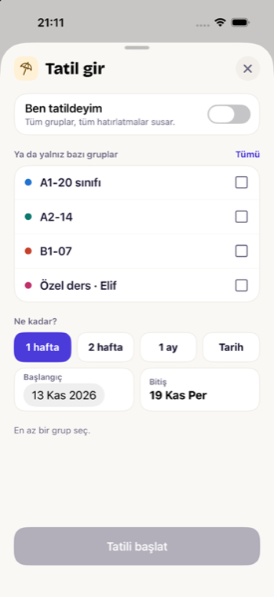
  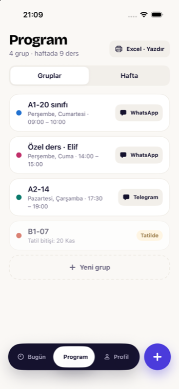
  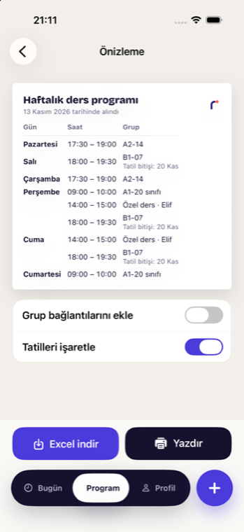
</p>
<p align="center">
  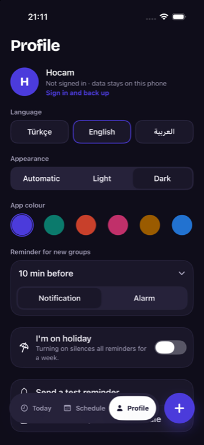
  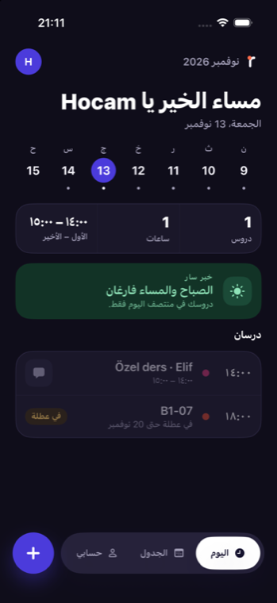
  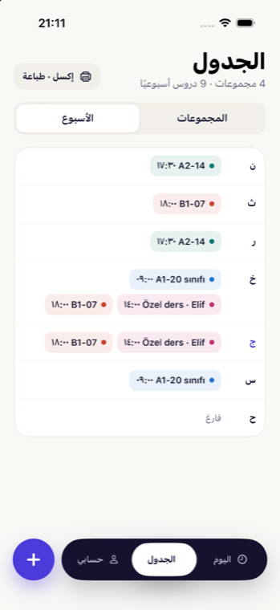
</p>

## Mimari

```
Remi/                     iOS uygulaması (SwiftUI, Observation)
  Core/                   Modeller, kurallar, günlük plan, TR/EN/AR metinler
  Data/                   AppStore (tek veri kaynağı, çevrimdışı kuyruk), Keychain
  Services/               Hatırlatmalar (UserNotifications, AlarmKit), API, giriş, eşitleme, Excel, yazdırma
  DesignSystem/           Marka, logo, ortak bileşenler
  Features/               Ekranlar
backend/                  .NET 10 API, DDD katmanlı
  src/Remi.Domain         Account ve Group aggregate'leri, value object'ler (bağımlılıksız)
  src/Remi.Application    Kullanım senaryoları ve port arayüzleri
  src/Remi.Infrastructure EF Core + PostgreSQL, Apple/Google kimlik doğrulama, JWT
  src/Remi.Api            Minimal API, güvenlik ayarları
```

- **Çevrimdışı öncelikli:** her değişiklik önce telefona yazılır; giriş yapılmışsa sunucuya gönderilir ve
  diğer cihazlardaki değişiklikler revizyon sayacıyla çekilir. Sürüm çakışmasında sunucudaki hal kazanır.
- **Hatırlatmalar:** tatilsiz gruplar haftalık tekrar eden bildirimle kurulur (uygulama açılmasa da çalışır);
  tatil varsa günler tek tek planlanır ve tatil günleri atlanır.
- **Aynı kurallar iki tarafta:** grup adı, sohbet bağlantısı, saat ve hatırlatma kuralları hem uygulamada hem
  sunucuda (value object'lerde) aynıdır.

Ayrıntılar: [backend/README.md](backend/README.md).

## Güvenlik

- Şifre tutulmaz; Apple/Google kimlik belgesi sunucuda imza, uygulama kimliği, süre ve nonce ile doğrulanır.
  Google girişi SDK'sız, PKCE ve `state` kontrolüyle.
- 15 dakikalık erişim anahtarı yalnız bellekte; yenileme anahtarı Keychain'de (yalnız bu cihaz) ve sunucuda
  yalnız özeti. Her kullanımda yenilenir; çalınıp tekrar kullanılırsa oturumun tüm anahtarları iptal edilir.
- Her hesap yalnız kendi verisini görür; başkasının kaydı "yok" görünür.
- Sohbet bağlantıları yalnız `https://chat.whatsapp.com`, `https://t.me`, `https://telegram.me` grup adresleri.
- Hız sınırı, istek boyutu sınırı, güvenlik başlıkları, iç ayrıntı vermeyen hata yanıtları.
- Hesap silme: hesap ve sunucudaki tüm veri kalıcı olarak silinir.

## Çalıştırma

**iOS** (Xcode 26+, iOS 17+):

```sh
open Remi.xcodeproj        # bir simülatör seç, ▶
./Tests/run.sh             # çekirdek testleri ve Excel doğrulaması (openpyxl gerekir)
```

Debug derlemesi API'yi `http://localhost:8080` adresinde arar; sunucu yoksa uygulama girişsiz çalışır.
Örnek veriyle belirli bir ekranı açmak için demo modu (yalnız Debug, diske yazmaz):

```sh
SIMCTL_CHILD_REMI_DEMO=1 SIMCTL_CHILD_REMI_SCREEN=today SIMCTL_CHILD_REMI_LANG=ar \
  xcrun simctl launch booted com.niloya.remi
```

**Backend** (.NET 10, Docker):

```sh
cd backend
dotnet test                              # 84 test (domain + uçtan uca API)
cp .env.example .env                     # POSTGRES_PASSWORD ve AUTH_SIGNING_KEY doldur
docker compose up -d --build
curl http://127.0.0.1:8080/health
```

## Durum

- [x] iOS uygulaması: tüm ekranlar, üç dil, açık/koyu tema, hatırlatmalar, tatil, Excel/yazdırma
- [x] Backend: giriş, profil, gruplar, eşitleme, hesap silme; testler
- [ ] Sunucunun yayına alınması ve Release'te API adresi
- [ ] Apple Developer: Sign in with Apple yeteneği ve TestFlight
- [ ] Google girişi için iOS istemci kimliği

## Teşekkür

Başlık yazı tipi [Bricolage Grotesque](https://github.com/ateliertriay/bricolage) (SIL Open Font License 1.1).
